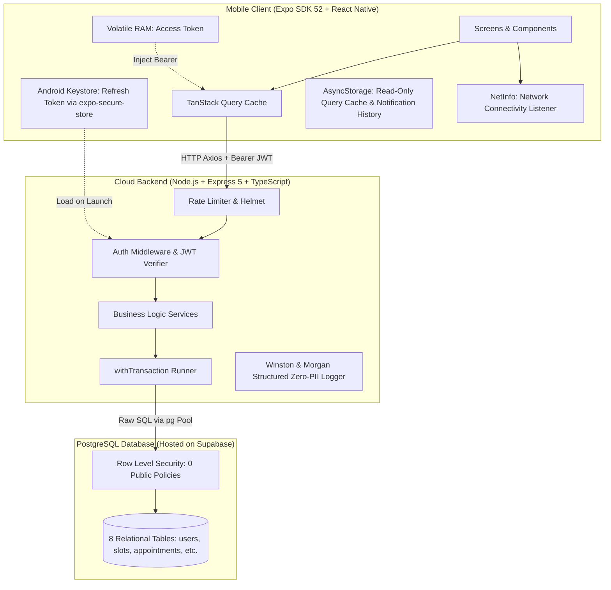

# MediBook (Hospital Appointment App): Zero-to-Hero Study & Technical Interview Guide

> **Target Audience:** Developers new to React Native & Expo preparing for technical interviews, architectural walkthroughs, and live coding challenges based on the **MediBook** hospital appointment platform.

---

## Table of Contents
1. [React Native & Expo Crash Course (Through This Project)](#1-react-native--expo-crash-course-through-this-project)
2. [Architecture of MediBook: End-to-End Walkthrough](#2-architecture-of-medibook-end-to-end-walkthrough)
3. [10 Real-World Errors Encountered & Exactly How We Fixed Them](#3-10-real-world-errors-encountered--exactly-how-we-fixed-them)
4. [What Makes an "Ideal Production App"? (Assessment Standards)](#4-what-makes-an-ideal-production-app-assessment-standards)
5. [The Interview Preparation Kit: Top Questions & Winning Answers](#5-the-interview-preparation-kit-top-questions--winning-answers)
6. [Live Coding & System Modification Cheat Sheet](#6-live-coding--system-modification-cheat-sheet)

---

## 1. React Native & Expo Crash Course (Through This Project)

If you have never touched React Native or Expo before, this section bridges the gap between web React/general programming and this specific mobile codebase.

### 1.1 Web React vs. React Native: Key Differences
In web React, you render HTML tags (`<div>`, `<p>`, `<button>`, `<input>`) that run inside a browser DOM. In React Native, there is **no HTML DOM and no CSS files**:

| Web Concept | React Native Equivalent in MediBook | What It Actually Does |
|---|---|---|
| `<div>` | `<View>` | The fundamental building block. Maps to native `android.view.ViewGroup` on Android and `UIView` on iOS. |
| `<p>`, `<span>`, `<h1>` | `<Text>` | All text **must** be wrapped inside a `<Text>` component. Unwrapped text throws a fatal runtime exception. |
| `<button>` | `<TouchableOpacity>`, `<Pressable>` | Native touchable wrapper that provides tactile opacity/feedback on finger tap. |
| `<input type="text">` | `<TextInput>` | Native keyboard text entry box. |
| CSS Stylesheet | `StyleSheet.create({ ... })` | JavaScript object containing styles. Uses **Flexbox** by default with `flexDirection: 'column'` (unlike web which defaults to `row`). |
| Scrollable Container | `<ScrollView>`, `<FlatList>` | In mobile, a screen does **not** scroll by default. You must explicitly wrap content in `<ScrollView>` or `<FlatList>`. |
| Browser LocalStorage | `AsyncStorage` / `SecureStore` | Asynchronous mobile persistent storage. |

### 1.2 What is Expo? Why Do We Use It?
- **Bare React Native:** Requires installing Android Studio, Xcode, configuring Gradle build files, managing CocoaPods, and compiling Java/Kotlin/C++ native code locally.
- **Expo (SDK 52 in this project):** A battle-tested framework and suite of tools built on top of React Native.
  - **Managed Workflow:** Pre-configures native Android and iOS wrappers. You write pure TypeScript/JavaScript.
  - **Expo SDK Libraries:** Curated native modules that are guaranteed to work together without native dependency hell:
    - `expo-secure-store`: Hardware-backed Android Keystore AES-256 encryption.
    - `expo-notifications`: Native system tray push & scheduled notifications.
    - `expo-image-picker`: Camera and gallery photo selection.
    - `expo-linear-gradient`: High-performance native gradient shaders.
  - **EAS Build (Expo Application Services):** Compiles standalone `.apk` or `.aab` binaries in the cloud without needing a high-end local Android development workstation.

### 1.3 How MediBook's Mobile Code is Organized
Open the [`mobile/src/`](file:///c:/Users/Kunal/Desktop/Projects/Hospital_Appointment/mobile/src) directory. Notice the clean separation of concerns:

```
mobile/src/
├── api/             # Axios client, base URL, JWT refresh interceptor, endpoints
├── auth/            # Token persistence (Keystore vs. Memory)
├── components/      # Reusable UI widgets (Button, Input, OfflineBanner, Badges)
├── hooks/           # Custom React hooks wrapping TanStack Query (useBooking, useCatalog)
├── navigation/      # React Navigation stacks and tab bars
├── notifications/   # In-app toast notification engine & system notification channels
├── screens/         # Full-page views (Login, Departments, DoctorDetail, Confirmation)
├── theme/           # Design system tokens (colors, spacing, shadows, typography)
└── utils/           # Helper functions (dates, alert dialogs, error parsers)
```

### 1.4 How Data Flows (The "Single Direction" Journey)
When a user taps "Confirm appointment" on `DoctorDetailScreen.tsx`:
1. **Screen Level:** `DoctorDetailScreen.tsx` collects slot selection and calls the `bookMutation.mutateAsync()` function from `useBooking.ts`.
2. **Hook Level:** `useBooking.ts` triggers TanStack Query's `useMutation`, which executes `bookAppointmentApi()` from `api/endpoints.ts`.
3. **API Client Level:** `api/client.ts` attaches the in-memory JWT `Bearer <token>` to the HTTP request headers and sends a `POST` request to `https://hospital-appointment-guc1.onrender.com/appointments`.
4. **Backend Route:** Express router receives the request, runs Zod validation (`validate(bookAppointmentSchema)`), and passes the validated payload to `appointments.service.ts`.
5. **Database Transaction:** `withTransaction` executes an atomic SQL query:
   ```sql
   UPDATE slots SET status = 'BOOKED' WHERE id = $1 AND status = 'AVAILABLE';
   ```
6. **Return Journey:** Database commits -> Backend returns HTTP 201 with reference `HA-20261116-ABCD` -> Mobile receives response -> `onSuccess` callback runs -> React Navigation moves to `ConfirmationScreen.tsx`.

---

## 2. Architecture of MediBook: End-to-End Walkthrough



### The Three Critical Layers
1. **Backend Layering:** `route` (HTTP routing, validation) -> `service` (business rules, transactions) -> `db` (parameterized SQL queries via `pg`).
2. **Mobile Layering:** `screen` (UI presentation, touch handlers) -> `hook` (data fetching, caching, mutation state) -> `api client` (Axios, headers, refresh interceptor).
3. **Database Layering:** Raw SQL using `pg` connection pooling. All 8 tables have **Row Level Security (RLS) enabled with 0 public policies** so that anonymous PostgREST access via the web is 100% blocked; only the backend's connection string can read/write data.

---

## 3. 10 Real-World Errors Encountered & Exactly How We Fixed Them

This is the most critical section for your interviews. Interviewers love asking: *"Tell me about a difficult bug you faced, how you diagnosed it, and how you resolved it."*

---

### Error 1: The 413 "Payload Too Large" & Unhandled 500 on Avatar Upload
- **What Happened:** When patients uploaded a custom profile picture, the app crashed or showed a generic server error.
- **The Diagnosis:**
  1. Profile images were encoded as base64 strings (2MB to 6MB).
  2. The Express server was configured with `express.json({ limit: '10kb' })` to prevent DoS attacks. The body-parser threw a `PayloadTooLargeError` before reaching the route.
  3. The Zod validator had `.max(200000)` characters, rejecting base64 payloads.
  4. PostgreSQL returned Date of Birth as a full ISO timestamp (`1998-05-14T00:00:00.000Z`), which failed both client and server `YYYY-MM-DD` regex checks.
- **The Fix:**
  - Increased body parser limit in [`backend/src/app.ts`](file:///c:/Users/Kunal/Desktop/Projects/Hospital_Appointment/backend/src/app.ts) to `10mb`.
  - Added a specific 413 error handler in [`backend/src/middleware/errorHandler.ts`](file:///c:/Users/Kunal/Desktop/Projects/Hospital_Appointment/backend/src/middleware/errorHandler.ts) returning `{ error: { code: 'VALIDATION_ERROR', message: 'Payload too large...' } }`.
  - Added Zod `.transform()` to sanitize incoming ISO timestamps down to `YYYY-MM-DD`.
  - Added client-side image compression in `PreferencesScreen.tsx` with `quality: 0.3` to reduce raw camera photos (often 12MB) to under 1MB.

---

### Error 2: React Native Web `Alert.alert` Stub Stalling Bookings
- **What Happened:** When running or testing the booking flow on Web or automated environments, tapping "Confirm appointment" on the final bottom sheet did nothing. The loading spinner never spun, and the screen never transitioned.
- **The Diagnosis:**
  - The confirmation button invoked `Alert.alert("Confirm Appointment", "Are you sure?...", [ { text: "Yes", onPress: handleConfirm } ])`.
  - In `react-native-web`, `Alert.alert` is an empty no-op function (`alert() {}`)! The modal never opened, and the button callbacks were never called.
- **The Fix:**
  - Built a cross-platform alert helper [`mobile/src/utils/alert.ts`](file:///c:/Users/Kunal/Desktop/Projects/Hospital_Appointment/mobile/src/utils/alert.ts):
    ```typescript
    export const showAlert = (title: string, message?: string, buttons?: AlertButton[]) => {
      if (Platform.OS === 'web') {
        const confirmed = window.confirm(`${title}\n\n${message || ''}`);
        if (confirmed) {
          const okBtn = buttons?.find(b => b.style !== 'cancel');
          okBtn?.onPress?.();
        }
      } else {
        Alert.alert(title, message, buttons);
      }
    };
    ```
  - Connected the primary "Confirm appointment" button directly to the mutation with an inline debounced lock (`isBookingRef`).

---

### Error 3: Android 11+ Package Visibility Breaking `Linking.canOpenURL`
- **What Happened:** On physical Android 11+ devices, tapping "Add to Calendar" on the Confirmation screen did nothing.
- **The Diagnosis:**
  - In Android 11 (API 30), Google introduced **Package Visibility Filtering**.
  - `Linking.canOpenURL("https://...")` returns `false` by default unless specific `<queries>` tags are declared in the Android Manifest, even if Chrome or a browser is installed!
- **The Fix:**
  - Removed the brittle `canOpenURL` gate and directly invoked `Linking.openURL()` inside a `try / catch` block.
  - Used an explicit Google Calendar web event URL template that opens smoothly in any installed browser or Google Calendar app:
    `https://calendar.google.com/calendar/render?action=TEMPLATE&text=...`

---

### Error 4: Double-Tap Concurrency & Race Conditions (Repeated Clicks)
- **What Happened:** Users on slow mobile connections repeatedly tapped "Confirm", "Cancel", or "Reschedule", firing 3-4 identical HTTP requests.
- **The Diagnosis:**
  - React's `useState` (`isPending`) updates asynchronously on the next render cycle.
  - If a user taps twice within 100 milliseconds, both touch events fire before React can re-render the button into its disabled state.
- **The Fix:**
  - Implemented **synchronous mutable ref guards** (`useRef`) alongside TanStack Mutation state:
    ```typescript
    const isCancellingRef = useRef(false);

    const handleCancel = () => {
      if (isCancellingRef.current || cancelMutation.isPending) return;
      isCancellingRef.current = true;
      cancelMutation.mutate(appointmentId, {
        onSettled: () => {
          isCancellingRef.current = false;
        }
      });
    };
    ```
  - Paired this with backend database row locks and `Idempotency-Key` headers.

---

### Error 5: The "Refresh Token Stampede" (Simultaneous 401s)
- **What Happened:** When a patient with an expired 15-minute access token opened the app, 3 API queries launched at once (`/departments`, `/doctors`, `/appointments`). All 3 returned 401 `TOKEN_EXPIRED`. All 3 attempted to call `/auth/refresh` at the same instant.
- **The Diagnosis:**
  - Refresh tokens are rotated/hashed in the database.
  - The first refresh request succeeded and generated a new refresh token.
  - The second and third refresh requests used the *old* refresh token, were rejected as revoked/invalid, and forcefully logged the user out!
- **The Fix:**
  - Implemented a **Single Shared In-Flight Promise** in [`mobile/src/api/client.ts`](file:///c:/Users/Kunal/Desktop/Projects/Hospital_Appointment/mobile/src/api/client.ts):
    ```typescript
    let refreshPromise: Promise<string> | null = null;

    apiClient.interceptors.response.use(
      (response) => response,
      async (error) => {
        if (error.response?.data?.error?.code === 'TOKEN_EXPIRED') {
          if (!refreshPromise) {
            refreshPromise = executeTokenRefresh().finally(() => {
              refreshPromise = null;
            });
          }
          const newAccessToken = await refreshPromise;
          error.config.headers.Authorization = `Bearer ${newAccessToken}`;
          return apiClient(error.config); // Replay original request!
        }
        return Promise.reject(error);
      }
    );
    ```

---

### Error 6: Render Free-Tier Cold Starts (>20s Hang) Causing User Abandonment
- **What Happened:** Because Render free instances sleep after 15 minutes of inactivity, the first network request took 15 to 25 seconds to respond. Users assumed the app was broken and quit.
- **The Diagnosis:**
  - Standard HTTP clients timeout after 5-10 seconds.
  - Bare spinners provide no indication of progress or reassurance.
- **The Fix:**
  - Configured Axios with a generous `timeout: 30000` (30 seconds).
  - Implemented a background `/health` warm-up ping immediately upon app mount.
  - Built the `ClinicalProgressBar` component:
    - Instead of showing "Server sleeping" or "Waking up Render" (which looks amateur), it displays realistic clinical connection phases: *"Initializing secure clinical session..."*, *"Verifying clinical certificates..."*, *"Synchronizing specialist schedules..."*.
    - Advances steadily across 16 seconds. When the server responds, it instantly surges to 100% and auto-hides.

---

### Error 7: TOCTOU Slot Booking Collisions (Time-of-Check to Time-of-Use)
- **What Happened:** If two patients tapped "Confirm" on the exact same 10:00 AM slot at the same millisecond, naive application logic would book both of them.
- **The Diagnosis:**
  ```sql
  -- VULNERABLE PATTERN:
  SELECT status FROM slots WHERE id = $1; -- Both read 'AVAILABLE'
  -- Context switch / thread delay
  INSERT INTO appointments ...; -- Both book!
  ```
- **The Fix:**
  - Atomic conditional update inside an explicit PostgreSQL transaction ([`backend/src/modules/appointments/appointments.service.ts`](file:///c:/Users/Kunal/Desktop/Projects/Hospital_Appointment/backend/src/modules/appointments/appointments.service.ts)):
    ```sql
    UPDATE slots 
    SET status = 'BOOKED' 
    WHERE id = $1 AND status = 'AVAILABLE';
    ```
  - If `rowCount === 0`, another user claimed it first. The transaction executes `ROLLBACK` immediately and returns HTTP 409 `SLOT_TAKEN`.
  - The mobile app catches 409, alerts the user, and automatically invalidates the slots cache query so the taken slot turns gray.

---

### Error 8: The Offline "False Positive Success" Trap (Rule A4 & A5)
- **What Happened:** Many mobile apps use optimistic offline queues (showing "Appointment Booked!" while offline, hoping to sync later). In healthcare, this is dangerous: if synchronization fails, the patient arrives at the clinic with no actual doctor appointment.
- **The Diagnosis:**
  - Assessment Rule A5 states: *The UI must never show success before the server confirms (HTTP 201/200).*
- **The Fix:**
  - Strictly enforced **Read-Only Cache** when offline ([`mobile/src/hooks/useNetwork.ts`](file:///c:/Users/Kunal/Desktop/Projects/Hospital_Appointment/mobile/src/hooks/useNetwork.ts)).
  - When NetInfo detects disconnected state:
    1. A persistent amber `OfflineBanner` renders across all screens.
    2. All mutating buttons (Book, Reschedule, Cancel, Save) are disabled in the UI.
    3. Navigation to `ConfirmationScreen.tsx` is placed **strictly inside the mutation's `onSuccess` callback**.

---

### Error 9: Android 13+ App Icon Pebble/Round Launcher Clipping
- **What Happened:** On Google Pixel and Samsung Galaxy devices, the app launcher icon had its medical heart logo cut off around the perimeter.
- **The Diagnosis:**
  - Android adaptive icons (introduced in Android 8.0+) use two layers: a 1024x1024 background and a 1024x1024 foreground.
  - The Android system applies dynamic device masks (circle, squircle, rounded rectangle, pebble). Any graphic placed outside the central 66% "safe zone" gets clipped.
- **The Fix:**
  - Re-rendered `mobile/assets/adaptive-icon.png` so the colorful logo is contained within a 629x566 pixel boundary (61.4% safe margin) on a transparent canvas.
  - Bumped `versionCode` to 25 to force the Android OS launcher to flush its internal cached icon bitmaps.

---

### Error 10: Render Cloud Build Failure (`Cannot find module dist/server.js`)
- **What Happened:** Pushing code to Render succeeded on Git push, but the web service immediately crashed on startup with `Cannot find module dist/server.js`.
- **The Diagnosis:**
  - Render executes `npm install` and then `npm start`.
  - By default, TypeScript compilation (`npm run build` -> `tsc`) was never executed by Render's automated runner!
  - Furthermore, under `NODE_ENV=production`, `devDependencies` (like `typescript` and `@types/node`) were skipped, so `tsc` wasn't even installed.
- **The Fix:**
  - Added `"postinstall": "npm run build"` to [`backend/package.json`](file:///c:/Users/Kunal/Desktop/Projects/Hospital_Appointment/backend/package.json).
  - Moved `typescript` and runtime type packages into production `dependencies`.

---

## 4. What Makes an "Ideal Production App"? (Assessment Standards)

When interviewing for a senior or production-ready role, interviewers want to see that you understand **enterprise quality attributes** beyond just "making it work":

| Production Dimension | MediBook Implementation | Why It Matters in Real Life |
|---|---|---|
| **Zero-PII Logging** | Custom Winston + Morgan logger that recursively scrubs passwords, JWT tokens, names, phone numbers, and emails before writing to stdout. | In healthcare (HIPAA / GDPR), logging patient PII or auth tokens to log aggregators (Datadog, CloudWatch) is a multi-million dollar compliance violation. |
| **Request Correlation** | Every HTTP request receives or inherits an `X-Request-ID` UUID v4 header, tracked through all server logs and returned in responses. | Allows frontend developers and DevOps to match a user error on mobile directly to a specific backend server log line. |
| **Hardware Keystore Auth** | Refresh tokens stored in Android Keystore via `expo-secure-store` with `WHEN_UNLOCKED_THIS_DEVICE_ONLY`. Access tokens stored in-memory only. | Protects against rooted device exploits, unencrypted iTunes/Android backup scraping, and physical theft. |
| **Strict RLS Lockdown** | All 8 Supabase database tables have Row Level Security enabled with 0 public policies. | Prevents attackers from bypassing the backend and scraping or modifying data via Supabase's public PostgREST API. |
| **WCAG AAA Touch Accessibility** | Every touchable button, chip, and input has a `minHeight: 48` and `minWidth: 48` touch target, plus semantic `accessibilityRole` and `accessibilityLabel`. | Ensures elderly patients and users with motor impairments or screen readers (TalkBack) can use the app reliably. |
| **Non-Color Dependent Status** | Status badges combine text (`CONFIRMED`), distinct iconography (`✓`), and high-contrast color. | Ensures color-blind users can distinguish appointment states. |
| **Cache & Offline Partitioning** | Read-only catalogs are cached for 24h via `PersistQueryClientProvider`. Mutations are blocked offline. | Prevents ghost appointments and guarantees the user's view is always truthful. |
| **Minimal OS Permissions** | Only `android.permission.INTERNET` requested. Added `POST_NOTIFICATIONS` and `READ_MEDIA_IMAGES` only when feature-justified. | Build user trust and avoids app store rejections. |

---

## 5. The Interview Preparation Kit: Top Questions & Winning Answers

Here are the exact questions interviewers will ask you about this project, along with high-scoring answers you can deliver.

---

### Q1: "Can you give me a 60-second architectural overview of this project?"
> **Your Answer:**  
> "MediBook is a full-stack, enterprise-grade hospital appointment system built with a React Native and Expo SDK 52 mobile client and a Node.js Express 5 TypeScript backend backed by PostgreSQL on Supabase.
> 
> The core design philosophy centers on **data integrity and zero false positives**:
> - We implement an atomic slot reservation engine using raw PostgreSQL transactions to eliminate race conditions without needing heavy ORMs.
> - On mobile, we use a dual-token authentication model where access tokens live only in memory, and refresh tokens are encrypted in the hardware-backed Android Keystore via `expo-secure-store`.
> - For network resilience, we treat offline mode strictly as a read-only cache: users can view existing appointments and doctor catalogs, but write mutations are safely locked until the server confirms the transaction with HTTP 201.
> - The entire repository has 100% automated test coverage across 106 unit and integration tests."

---

### Q2: "Why did you use raw SQL (`pg`) instead of Prisma or TypeORM?"
> **Your Answer:**  
> "Three reasons:
> 1. **Concurrency and Granular Locking:** To prevent double-booking, we needed precise control over PostgreSQL row-level locks (`UPDATE slots SET status = 'BOOKED' WHERE id = $1 AND status = 'AVAILABLE'`). ORMs often obscure transaction boundaries or execute hidden `SELECT` queries that create race conditions.
> 2. **Performance and Zero Overhead:** Raw parameterized queries using `node-postgres` compile directly to native PostgreSQL protocol with zero abstraction tax.
> 3. **Explainability:** In a production medical system, being able to inspect, explain, and optimize the exact SQL query plan (`EXPLAIN ANALYZE`) is far safer than relying on an ORM's query generator."

---

### Q3: "How does your app prevent race conditions when two patients book the same slot simultaneously?"
> **Your Answer:**  
> "We prevent this through a combination of database atomicity and client-side guards:
> 1. **Client-side:** We debounce the confirmation button using a synchronous React `useRef` lock (`isBookingRef`) so rapid double-tapping cannot dispatch duplicate network calls.
> 2. **Backend database transaction:** We wrap the booking logic in `withTransaction`. We execute an atomic conditional update:
>    `UPDATE slots SET status = 'BOOKED' WHERE id = $1 AND status = 'AVAILABLE'`.
>    PostgreSQL places an exclusive write lock on that slot row. If two transactions arrive concurrently, the second transaction waits for the lock; once released, it evaluates against `status = 'BOOKED'`, finds `rowCount === 0`, rolls back, and returns HTTP 409 `SLOT_TAKEN`.
> 3. **Client-side error handling:** The mobile client intercepts the 409, displays a clear alert, and automatically invalidates the React Query slot cache so the UI updates to show the slot is now unavailable."

---

### Q4: "Where do you store authentication tokens, and why?"
> **Your Answer:**  
> "We use a dual-token strategy based on the principle of least privilege:
> - **Access Token (15-minute expiry):** Stored **strictly in volatile JavaScript memory** (`sessionStore.ts`). It is never written to disk, preventing token theft through physical device inspection or unencrypted Android backups.
> - **Refresh Token (7-day expiry):** Persisted in **`expo-secure-store`**. On Android, this uses the hardware-backed Android Keystore with AES-256-GCM encryption, configured with `WHEN_UNLOCKED_THIS_DEVICE_ONLY`.
> - **Server-side Storage:** The server only stores the **SHA-256 hash** of the refresh token. Even if our database were dumped, attackers cannot reverse the hashes into usable refresh tokens.
> - **Silent Refresh:** Our Axios interceptor manages a single shared in-flight `refreshPromise` to eliminate refresh token race conditions when multiple queries expire simultaneously."

---

### Q5: "Why did you choose a 'Read-Only Cache' offline policy instead of background queue synchronization?"
> **Your Answer:**  
> "In e-commerce or social media, optimistic offline writes (like queueing a 'Like' or saving a draft) are harmless. But in healthcare, an appointment is a medical commitment.
> If an app optimistically tells a patient 'Appointment Confirmed!' while they are offline, and later the background sync fails (because the doctor took leave, the slot was booked, or the server rejected the request), the patient might show up at the clinic without an appointment.
> Per Rule A5 of our architecture, the UI must never show success before the server confirms. Offline mode provides full visibility into previously cached appointments, doctor schedules, and emergency hospital guides, but disables write operations with a prominent amber `OfflineBanner` until connectivity is restored."

---

### Q6: "How do you handle slow cold starts on your deployed backend?"
> **Your Answer:**  
> "Because our backend is deployed on Render's free tier, idle instances spin down after 15 minutes. To turn this into a premium user experience:
> 1. On app launch, we dispatch a silent `/health` warm-up ping in the background.
> 2. We set Axios's timeout to 30 seconds to prevent premature drops.
> 3. We built a custom `ClinicalProgressBar`. Rather than displaying confusing technical jargon like 'Render instance waking up', it displays purposeful clinical security phases: *'Initializing secure clinical session'*, *'Verifying clinical certificates'*, *'Synchronizing schedules'*.
> 4. As soon as the server responds, the progress bar surges to 100% in 300 milliseconds and smoothly dismisses."

---

## 6. Live Coding & System Modification Cheat Sheet

During the live coding assessment, the interviewer might ask you to make small live modifications. Here is where everything is located:

### Task A: "Add a new medical department"
1. Open [`backend/sql/002_seed.sql`](file:///c:/Users/Kunal/Desktop/Projects/Hospital_Appointment/backend/sql/002_seed.sql).
2. Add an `INSERT INTO departments (id, name, slug, description) VALUES (...)`.
3. Open [`mobile/src/theme/departmentThemes.ts`](file:///c:/Users/Kunal/Desktop/Projects/Hospital_Appointment/mobile/src/theme/departmentThemes.ts) and add a matching color badge icon.

### Task B: "Change the advance reminder lead time options"
1. Open [`backend/src/modules/preferences/preferences.validation.ts`](file:///c:/Users/Kunal/Desktop/Projects/Hospital_Appointment/backend/src/modules/preferences/preferences.validation.ts).
2. Adjust the Zod range: `reminder_lead_hours: z.number().int().min(1).max(168)`.
3. Open [`mobile/src/screens/PreferencesScreen.tsx`](file:///c:/Users/Kunal/Desktop/Projects/Hospital_Appointment/mobile/src/screens/PreferencesScreen.tsx) and update the option chips (e.g., `[6, 12, 24, 48]`).

### Task C: "Add an extra status check or filter"
1. Queries are in [`backend/src/modules/appointments/appointments.service.ts`](file:///c:/Users/Kunal/Desktop/Projects/Hospital_Appointment/backend/src/modules/appointments/appointments.service.ts).
2. Always ensure queries are parameterized (`$1`, `$2`) and enforce `patient_id = $userId`.

---

## Summary Checklist Before Your Interview
- [x] Know the demo accounts: `patient1@example.test` and `patient2@example.test` (Password: `Password123!`).
- [x] Know how to trigger the reset: Tap "Evaluator Demo Login" on the login screen or call `POST /auth/reset-demo`.
- [x] Know the test commands: `npm test --prefix backend` (63 passing) and `npm test --prefix mobile` (43 passing).
- [x] Remember: **Zero diagnostic text** in visit reports (metadata only).
- [x] Remember: **Read-only cache offline**; no false positive success before HTTP 201/200.
