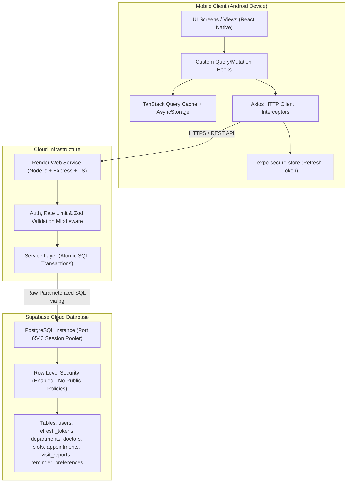
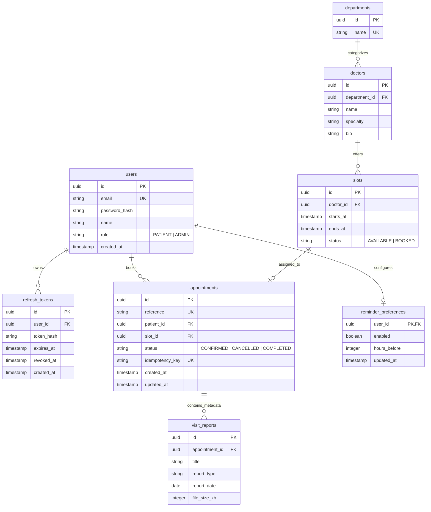
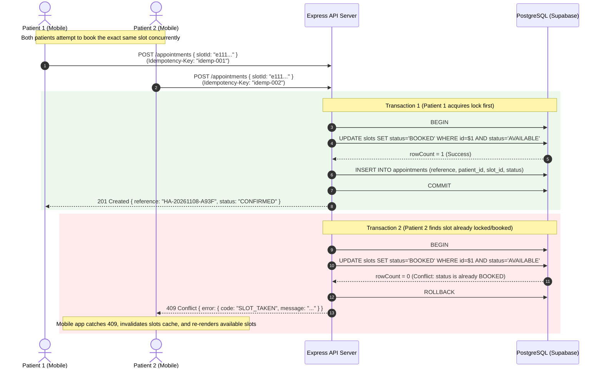
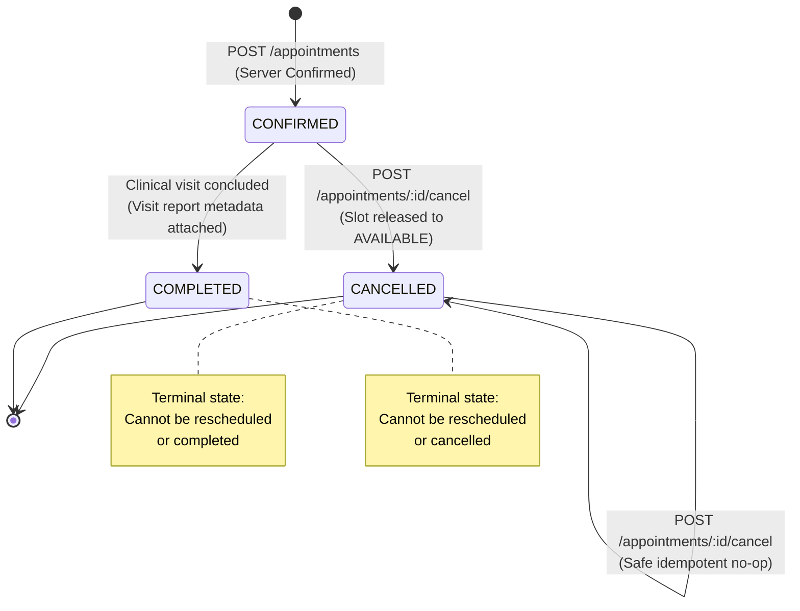

# System Architecture & Diagrams

> Assessment: Algions AI Labs — Hospital Appointment Android Application  
> Domain: Hospital Management  
> Version: 2.0.0

---

## 1. High-Level Component Diagram



---

## 2. Entity-Relationship (ER) Diagram



---

## 3. Booking Sequence Diagram (Concurrency & Conflict Paths)



---

## 4. Appointment Status State Machine



---

## 5. Mobile Architectural Layering

```
┌────────────────────────────────────────────────────────┐
│                   Screens & UI Layer                   │
│   (Login, DoctorsList, DoctorDetail, SlotPicker,      │
│    BookingConfirm, AppointmentsList, AppointmentDetail)│
└───────────────────────────┬────────────────────────────┘
                            │ Calls custom hooks
┌───────────────────────────▼────────────────────────────┐
│                    Hooks & Store                       │
│   (useDoctors, useSlots, useBookSlot, useAppointments, │
│    useSessionStore, useNetworkStatus)                  │
└───────────────────────────┬────────────────────────────┘
                            │ Reads/Writes
┌───────────────────────────▼────────────────────────────┐
│             Cache & Offline Storage Layer              │
│   (TanStack Query Cache + AsyncStorage Persister)      │
│   * Note: Writes disabled when offline                 │
└───────────────────────────┬────────────────────────────┘
                            │ Dispatches network requests
┌───────────────────────────▼────────────────────────────┐
│            API Client & Auth Interceptors              │
│   (Axios Client, 30s Timeout, Token Refresh Promise,   │
│    expo-secure-store for Refresh Token)                │
└───────────────────────────┬────────────────────────────┘
                            │ HTTPS
                            ▼
                    Backend REST API
```

---

## 6. Key Security & Integrity Guarantees

1. **No Sensitive PII:** Synthetic patients and doctors only.
2. **Metadata-Only Reports:** Schema strictly enforces that visit reports have only `title`, `report_type`, `report_date`, and `file_size_kb`. No medical diagnoses or treatment recommendations exist.
3. **Database Security (RLS Enabled):** All 8 PostgreSQL tables have Row Level Security enabled with 0 policies. Public anonymous access to Supabase PostgREST endpoints is completely blocked.
4. **Atomic Concurrency Protection:** Slots are reserved via `UPDATE slots SET status='BOOKED' WHERE id=$1 AND status='AVAILABLE'` inside an explicit database transaction. Concurrency conflicts trigger HTTP 409 `SLOT_TAKEN` with automatic UI refetching.
5. **Ownership Isolation:** All appointment queries enforce `patient_id = $userId`. Records belonging to other users return HTTP 404 `NOT_FOUND` to prevent resource enumeration.
